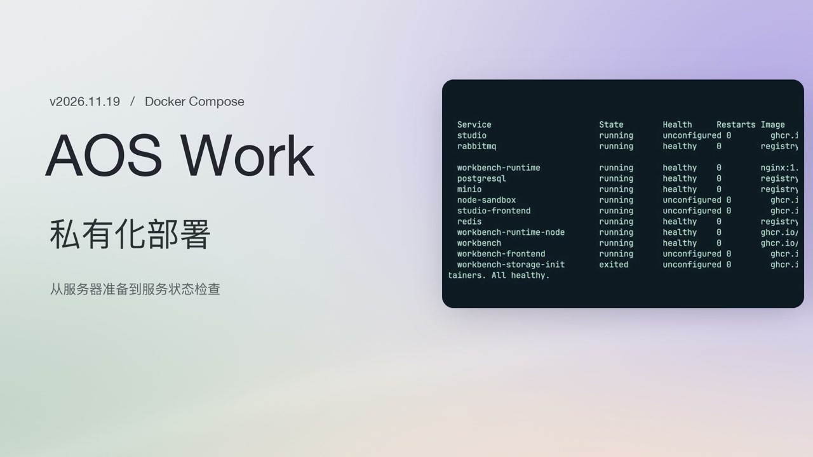

# AOS Work 私有化部署

[](https://basilos-ai.github.io/aos-work-release/)

| 语言 / Language | 在线观看 / Watch | 视频 / MP4 | 字幕 / Captions |
| --- | --- | --- | --- |
| 中文 | [播放中文版 · 3 分 45 秒](https://basilos-ai.github.io/aos-work-release/) | [下载视频](https://basilos-ai.github.io/aos-work-release/media/aos-work-deployment.mp4?v=76a68a9f) | [中文字幕](https://basilos-ai.github.io/aos-work-release/media/aos-work-deployment.zh.vtt?v=76a68a9f) |
| English | [Watch in English · 3 min 50 sec](https://basilos-ai.github.io/aos-work-release/en/) | [Download video](https://basilos-ai.github.io/aos-work-release/media/aos-work-deployment.en.mp4?v=dd69daf0) | [English captions](https://basilos-ai.github.io/aos-work-release/media/aos-work-deployment.en.vtt?v=dd69daf0) |

[下载自动预检安装器](https://github.com/basilos-ai/aos-work-release/releases/download/v2026.11.25.1/deploy.sh)

## 开始部署

1. 准备至少 4 核 CPU、8 GB 内存、100 GB 存储的 Linux 主机，配置域名解析并放行入站 TCP 80、443。
2. 首次部署时将单文件安装器放入服务器专用目录，例如 `/home/aos-work`。已有部署继续使用原目录。
3. 在服务器终端启动安装器，按屏幕提示操作。

```sh
sudo bash /home/aos-work/deploy.sh
```

启动后先看 `Host preflight` 的 CPU、内存、磁盘和端口结果。主菜单依次选择 **1** 配置域名和 HTTPS、**2** 获取部署包、**3** 部署服务。完成后选择 **6** 查看容器状态。

[版本说明与离线安装包](https://github.com/basilos-ai/aos-work-release/releases/tag/v2026.11.25.1)
